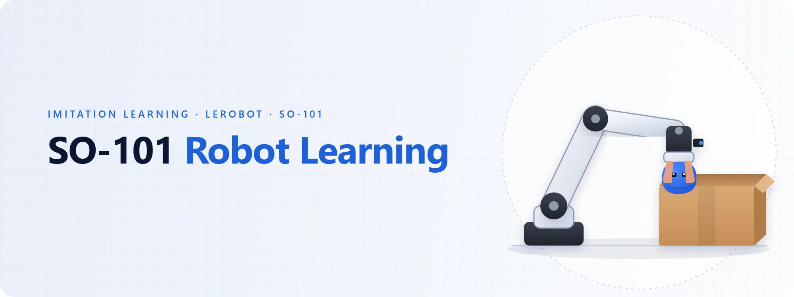
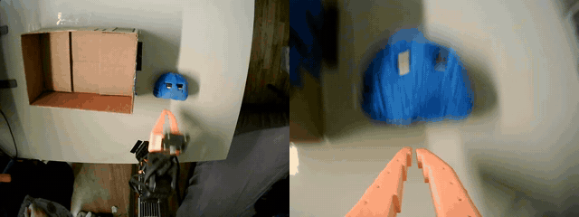
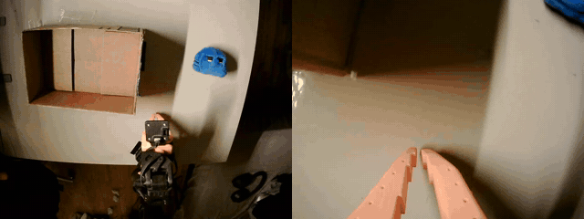
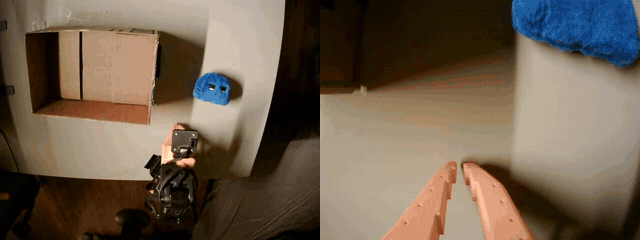
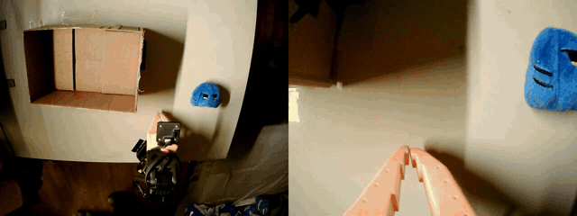

<div align="center">



<br />

**English** · [简体中文](README.zh-CN.md)


</div>

Four robot-learning policies, from a 52M-parameter Transformer to a 4.1B-parameter vision-language-action model, trained on
the same 50 teleoperated demonstrations and evaluated the same way on a low-cost **SO-101** arm, against a **training-free baseline**:
a general vision-language model that was never trained on robot data and decides every step itself, driving the arm through inverse kinematics.
Everything runs end to end on real hardware: data collection → training → deployment → 40-trial evaluation per policy.

**Task:** pick up a plush toy from one of 5 marked spots and put it in a cardboard box.
**Dataset:** 50 demonstrations, [`Yufeng1216/so101_pick_place`](https://huggingface.co/datasets/Yufeng1216/so101_pick_place).

| ACT · spot ⑤ | Diffusion Policy · spot ② | SmolVLA · spot ③ | VLM agent · spot ⑤ |
|---|---|---|---|
|  |  |  |  |

<sub>Autonomous rollouts recorded during evaluation, 2× speed. Left of each clip: overhead camera; right: wrist camera.
VLM agent: a separate demo run after the evaluation (same frozen agent), 3× speed, with the still pauses while the model thinks cut short; the whole attempt took 122 s.</sub>

## How it works

| Policy | Paper | Params | Idea | Trained on |
|---|---|---|---|---|
| **ACT** | [Zhao et al., 2023](https://arxiv.org/abs/2304.13705) | 52 M | CVAE + DETR-style Transformer, predicts 100-step action chunks | laptop RTX 3070 (8 GB) |
| **Diffusion Policy** | [Chi et al., 2023](https://arxiv.org/abs/2303.04137) | 278 M | denoises a 64-step action sequence with a 1D U-Net (DDPM training, DDIM sampling) | GPU cluster, V100 16 GB |
| **SmolVLA** | [Shukor et al., 2025](https://arxiv.org/abs/2506.01844) | 450 M | pretrained small VLM + flow-matching action expert, fine-tuned | GPU cluster, V100 16 GB |
| **π₀.₅** | [Physical Intelligence, 2025](https://arxiv.org/abs/2504.16054) | 4.1 B | PaliGemma + flow-matching expert with joint attention, full fine-tune | rented A100 80 GB (HF Jobs) |
| **VLM agent + IK** | — | Claude Haiku 5.5 (API) | the VLM looks at both cameras and decides every step through `move_to` / `gripper` / `done` tools; IK only turns positions into joint angles | no training |

- **Same data, same test.** All learned policies use the one dataset; every policy gets 40 trials (5 spots × 8) under the lighting the demos were recorded in, each policy in one go with a cool-down in between ([protocol](docs/08_evaluation.md)).
- **Standard recipes.** Each policy is trained with its paper / LeRobot defaults; only what the hardware forces is changed (image size, batch, steps), and every change is explained in its tutorial.
- **Native Windows.** No WSL, VM or ROS: serial ports, cameras and CUDA work directly. Bigger models train on a Slurm cluster or a rented GPU from the same repo ([cloud/](cloud/)).

## Results

> **Status:** all five evaluated, 40 real-robot trials each.

| Policy | Success | 95% CI | Grasped, not placed | Not grasped | Per spot ①②③④⑤ | Sheet · videos |
|---|---|---|---|---|---|---|
| ACT | **14/40** (35%) | 22–51% | 4 | 22 | 1 · 0 · 2 · 6 · 5 | [act](results/act.md) · [🤗](https://huggingface.co/datasets/Yufeng1216/rollout_eval_act) |
| Diffusion Policy | **25/40** (62.5%) | 47–76% | 7 | 8 | 6 · 6 · 4 · 7 · 2 | [diffusion](results/diffusion.md) · [🤗](https://huggingface.co/datasets/Yufeng1216/rollout_eval_diffusion) |
| SmolVLA | **26/40** (65%) | 50–78% | 0 | 14 | 2 · 3 · 7 · 7 · 7 | [smolvla](results/smolvla.md) · [🤗](https://huggingface.co/datasets/Yufeng1216/rollout_eval_smolvla) |
| π₀.₅ | **34/40** (85%) | 71–93% | 0 | 6 | 7 · 5 · 7 · 8 · 7 | [pi05](results/pi05.md) · [🤗](https://huggingface.co/datasets/Yufeng1216/rollout_eval_pi05) |
| VLM agent + IK | **29/40** (72.5%) | 57–84% | 3 | 8 | 7 · 6 · 7 · 4 · 5 | [vlm_agent](results/vlm_agent.md) · [🤗](https://huggingface.co/datasets/Yufeng1216/vlm_agent_eval_logs) |

<sub>Success = toy released inside the box within 30 s (VLM agent: within 25 model calls, see [docs/09](docs/09_zero_shot_vlm.md)). 95% CI: Wilson score interval. Per spot: successes out of 8.
Diffusion and SmolVLA are each better than ACT (Fisher's exact test p = 0.025 and 0.013); they are not distinguishable from each other (p = 1.0).
π₀.₅ is better than ACT (p < 0.0001) and Diffusion (p = 0.041); vs. SmolVLA p = 0.069. π₀.₅ ran on a cloud GPU through remote inference ([docs/07](docs/07_pi05.md)).
The VLM agent is better than ACT (p = 0.002) and not distinguishable from Diffusion, SmolVLA or π₀.₅ (p = 0.47, 0.63, 0.27).</sub>

**In short**

- **Pretraining pays off.** The two pretrained VLAs never dropped a grasped toy, and π₀.₅ (4.1 B, full fine-tune) was the most reliable at 34/40; ACT, trained from scratch on the same 50 demos, managed 14/40.
- **A general model with no robot training gets surprisingly far.** Claude Haiku 5.5, given only measured geometry and four tools, placed the toy 29 times out of 40, statistically level with the trained policies except ACT.
- **But it is slow.** It thinks before every action: a median 100 s and about $0.03 per trial, against a learned policy acting at 30 Hz. It was weakest at spot ④, next to the box wall.
- **Caveat:** 40 trials per policy give wide intervals; only the differences with ACT (and π₀.₅ vs. Diffusion) are significant.

| Policy | Steps × batch | Samples seen (epochs) | Train time | Inference per chunk | Model |
|---|---|---|---|---|---|
| ACT | 50k × 8 | 400k (≈27) | 4.0 h, RTX 3070 Laptop | ~47 ms | [🤗](https://huggingface.co/Yufeng1216/act_so101_pick_place) |
| Diffusion Policy | 100k × 8 | 800k (≈53) | ≈4 h, V100 | ~200 ms (DDIM, 10 steps) | [🤗](https://huggingface.co/Yufeng1216/diffusion_so101_pick_place) |
| SmolVLA | 20k × 32 | 640k (≈43) | ≈14 h, V100 | ~0.38 s, RTX 3070 Laptop | [🤗](https://huggingface.co/Yufeng1216/smolvla_so101_pick_place) |
| π₀.₅ | 3k × 32 | 96k (≈6) | 7.1 h, A100 80 GB (≈ $18) | ~0.45 s, A10G (HF Jobs, remote) | [🤗](https://huggingface.co/Yufeng1216/pi05_so101_pick_place) |

<sub>Steps aren't comparable across rows (different batch sizes, model sizes and pretraining), so samples seen and training time are listed to compare budgets. Epochs over the 15k-frame training split.</sub>

## Repository

```text
config/          robot.example.json → copy to robot.json (COM ports, camera indices, HF user); arm calibration
scripts/         runs on the Windows laptop: hardware checks, recording, local training, evaluation, GIFs
cloud/           runs elsewhere: Slurm cluster (Diffusion, SmolVLA) and Hugging Face Jobs (π₀.₅)
zero_shot/       the training-free baseline: SO-101 kinematics, touch calibration, the Claude Haiku agent
docs/            the tutorial, one file per stage (English *.md, Chinese *.zh-CN.md)
results/         per-trial evaluation sheets
assets/          GIFs for this page
```

## Quick start

- **Set up**: conda env with Python 3.12, PyTorch (CUDA 12.8) and `lerobot[...]==0.7.0`, then copy `config/robot.example.json` to `config/robot.json` ([docs/00](docs/00_environment.md)).
- **Check the hardware**: `python scripts/find_hardware.py` and `python scripts/scan_motors.py --port COM3` ([docs/01](docs/01_hardware.md)).
- **Record**: `.\scripts\robot.ps1 record -Name so101_pick_place -Episodes 10` ([docs/03](docs/03_data_collection.md)).
- **Train**: `.\scripts\train.ps1 act` on the laptop, or `bash cloud/slurm/submit.sh diffusion` on a cluster ([docs/04](docs/04_act.md)–[07](docs/07_pi05.md)).
- **Evaluate**: `.\scripts\robot.ps1 eval -Policy <model dir> -Name <policy> -Episodes 5`, eight times per policy ([docs/08](docs/08_evaluation.md)).

## Tutorial

The model chapters (4–7, 9) build each architecture up from the basics (VAE → CVAE, DDPM → DDIM, flow matching, VLM internals, homography and IK) before the commands.
New to the tooling? Start with [how this repo works](docs/how_this_repo_works.md).

| # | Stage | Doc |
|---|---|---|
| 0 | Environment setup on Windows | [docs/00_environment.md](docs/00_environment.md) |
| 1 | Hardware: ports, motor IDs, cameras | [docs/01_hardware.md](docs/01_hardware.md) |
| 2 | Calibration and teleoperation | [docs/02_calibration_teleop.md](docs/02_calibration_teleop.md) |
| 3 | Recording a dataset | [docs/03_data_collection.md](docs/03_data_collection.md) |
| 4 | ACT | [docs/04_act.md](docs/04_act.md) |
| 5 | Diffusion Policy | [docs/05_diffusion_policy.md](docs/05_diffusion_policy.md) |
| 6 | SmolVLA | [docs/06_smolvla.md](docs/06_smolvla.md) |
| 7 | π₀.₅ | [docs/07_pi05.md](docs/07_pi05.md) |
| 8 | Evaluation protocol | [docs/08_evaluation.md](docs/08_evaluation.md) |
| 9 | Training-free baseline: VLM agent + IK | [docs/09_zero_shot_vlm.md](docs/09_zero_shot_vlm.md) |
| – | Code walkthrough (every script explained) | [docs/code_walkthrough.md](docs/code_walkthrough.md) |

## Hardware

- SO-101 follower arm (6× Feetech STS3215) + SO-101 leader arm for teleoperation
- Two USB servo boards (WCH CH343 and CH340)
- Two USB cameras, 640×480 @ 30 fps: `top` (overhead, on a desk-lamp arm) and `wrist` (on the gripper)
- Laptop: Windows 11, RTX 3070 Laptop GPU (8 GB)

## License

Code under the MIT License ([LICENSE](LICENSE)). Built on [LeRobot](https://github.com/huggingface/lerobot) (Apache-2.0) and the open-source [SO-ARM100/101](https://github.com/TheRobotStudio/SO-ARM100) arm.
