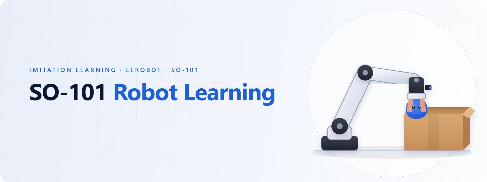
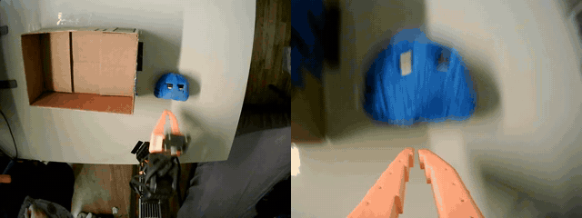
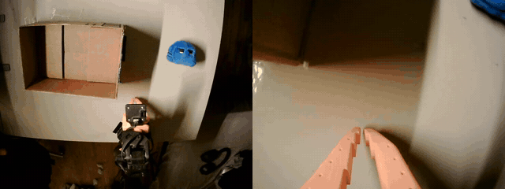
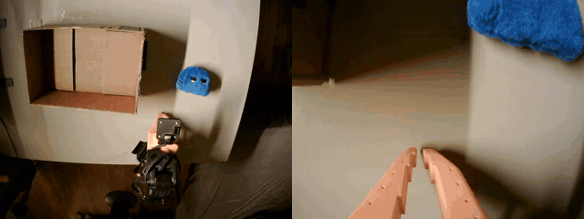
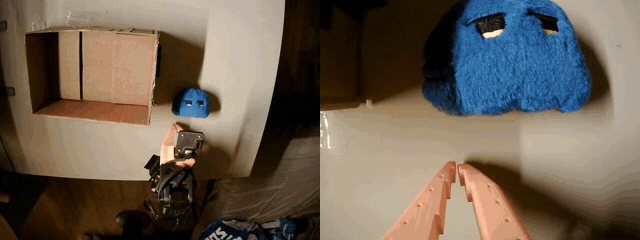
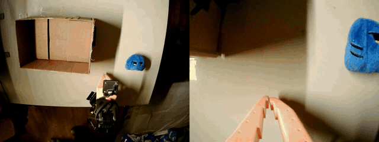
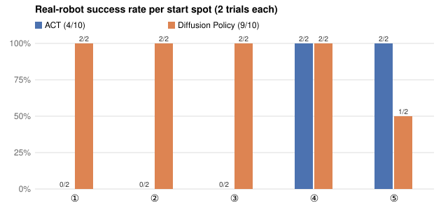

<div align="center">



<br />

[English](README.md) · **简体中文**


</div>

四个机器人学习策略，从 5200 万参数的 Transformer 到 41 亿参数的视觉-语言-动作模型，用同一份 50 条遥操作示范训练，
在低成本的 **SO-101** 机械臂上用同一套方法评估；再和一个**免训练基线**对比：一个没在机器人数据上训练过的通用视觉语言模型自己决定每一步，通过逆运动学驱动机械臂。
全流程都在真机上：采集数据 → 训练 → 部署 → 每个策略 40 次真机评估。

**任务：** 从 5 个标记点之一抓起毛绒玩具，放进快递盒。
**数据集：** 50 条示范，[`Yufeng1216/so101_pick_place`](https://huggingface.co/datasets/Yufeng1216/so101_pick_place)。

| ACT · 点位 ⑤ | Diffusion Policy · 点位 ② | SmolVLA · 点位 ③ |
|---|---|---|
|  |  |  |

| π₀.₅ · 点位 ④ | VLM 智能体（Claude Haiku 5.5）· 点位 ⑤ |
|---|---|
|  |  |

<sub>评估时录下的自主运行片段，2 倍速。每段左边是俯视相机，右边是腕部相机。
VLM 智能体：评估结束后单独录的一次演示（同一个冻结的智能体），3 倍速，模型思考时机械臂静止的停顿剪短了；这次尝试实际用了 122 秒。</sub>

## 工作原理

| 策略 | 论文 | 参数量 | 思路 | 在哪训练 |
|---|---|---|---|---|
| **ACT** | [Zhao et al., 2023](https://arxiv.org/abs/2304.13705) | 52 M | CVAE + DETR 式 Transformer，一次预测 100 步动作块 | 笔记本 RTX 3070（8 GB） |
| **Diffusion Policy** | [Chi et al., 2023](https://arxiv.org/abs/2303.04137) | 278 M | 用 1D U-Net 对 64 步动作序列去噪（DDPM 训练，DDIM 采样） | GPU 集群，V100 16 GB |
| **SmolVLA** | [Shukor et al., 2025](https://arxiv.org/abs/2506.01844) | 450 M | 预训练的小型 VLM + flow matching 动作专家，微调 | GPU 集群，V100 16 GB |
| **π₀.₅** | [Physical Intelligence, 2025](https://arxiv.org/abs/2504.16054) | 4.1 B | PaliGemma + flow matching 动作专家（联合注意力），全量微调 | 租用的 A100 80 GB（HF Jobs） |
| **VLM 智能体 + IK** | — | Claude Haiku 5.5（API） | VLM 看两路相机，通过 `move_to` / `gripper` / `done` 工具决定每一步；IK 只负责把位置换算成关节角 | 不训练 |

- **同样的数据，同样的测试。** 所有学习型策略用同一份数据集；每个策略测 40 次（5 个点 × 8），光照和录示范时一样，一个策略连续测完、中间冷却（[评估协议](docs/08_evaluation.zh-CN.md)）。
- **标准配方。** 每个策略都按论文 / LeRobot 的默认配置训练，只改硬件逼着改的地方（图像大小、batch、步数），每一处改动都在对应教程里说明。
- **原生 Windows。** 不用 WSL、虚拟机或 ROS：串口、相机、CUDA 直接可用。大模型在同一个仓库里提交到 Slurm 集群或租用的 GPU 上训练（[cloud/](cloud/README.zh-CN.md)）。

## 结果

> **状态：** 五个都测完了，每个 40 次真机评估。

| 策略 | 成功 | 95% 区间 | 抓起没放进 | 没抓起 | 各点位 ①②③④⑤ | 成功用时 | 记录 · 录像 |
|---|---|---|---|---|---|---|---|
| ACT | **14/40**（35%） | 22–51% | 4 | 22 | 1 · 0 · 2 · 6 · 5 | 12 s · RTX 3070 Laptop | [act](results/act.zh-CN.md) · [🤗](https://huggingface.co/datasets/Yufeng1216/rollout_eval_act) |
| Diffusion Policy | **25/40**（62.5%） | 47–76% | 7 | 8 | 6 · 6 · 4 · 7 · 2 | 15 s · RTX 3070 Laptop | [diffusion](results/diffusion.zh-CN.md) · [🤗](https://huggingface.co/datasets/Yufeng1216/rollout_eval_diffusion) |
| SmolVLA | **26/40**（65%） | 50–78% | 0 | 14 | 2 · 3 · 7 · 7 · 7 | 14 s · RTX 3070 Laptop | [smolvla](results/smolvla.zh-CN.md) · [🤗](https://huggingface.co/datasets/Yufeng1216/rollout_eval_smolvla) |
| π₀.₅ | **34/40**（85%） | 71–93% | 0 | 6 | 7 · 5 · 7 · 8 · 7 | 11 s · A10G（远程） | [pi05](results/pi05.zh-CN.md) · [🤗](https://huggingface.co/datasets/Yufeng1216/rollout_eval_pi05) |
| VLM 智能体 + IK | **29/40**（72.5%） | 57–84% | 3 | 8 | 7 · 6 · 7 · 4 · 5 | 92 s · Claude API | [vlm_agent](results/vlm_agent.zh-CN.md) · [🤗](https://huggingface.co/datasets/Yufeng1216/vlm_agent_eval_logs) |

<sub>成功 = 30 秒内玩具放进盒子并松开（VLM 智能体：25 次模型调用之内，见 [docs/09](docs/09_zero_shot_vlm.zh-CN.md)）。95% 区间：Wilson 区间。各点位：8 次里成功几次。成功用时：成功的那些次的中位数，从开始到松手的真实秒数
（训练的策略：录到的帧数按控制循环的实际频率换算，另含操作者按键结束的反应时间；VLM 智能体：实际墙钟时间）。
评估时各策略在哪里运行：ACT、Diffusion、SmolVLA 在笔记本的 RTX 3070 Laptop GPU（8 GB）上；π₀.₅ 通过远程推理在 HF Jobs 的 A10G（24 GB）上；
VLM 智能体的模型在 Anthropic 的 API 上，IK 和安全检查在笔记本 CPU 上。下表的推理时间也是在同样的机器上测的。
Diffusion 和 SmolVLA 都显著好于 ACT（Fisher 精确检验 p = 0.025 和 0.013），两者之间分不出差别（p = 1.0）。
π₀.₅ 好于 ACT（p < 0.0001）和 Diffusion（p = 0.041）；和 SmolVLA 比 p = 0.069。π₀.₅ 在云端 GPU 上通过远程推理运行（[docs/07](docs/07_pi05.zh-CN.md)）。
VLM 智能体好于 ACT（p = 0.002），和 Diffusion、SmolVLA、π₀.₅ 分不出差别（p = 0.47、0.63、0.27）。</sub>



| 策略 | 步数 × batch | 看过的样本（epoch） | 训练时长 | 推理 | 模型 |
|---|---|---|---|---|---|
| ACT | 50k × 8 | 400k (≈27) | 4.0 h，RTX 3070 Laptop | ~47 ms，RTX 3070 Laptop | [🤗](https://huggingface.co/Yufeng1216/act_so101_pick_place) |
| Diffusion Policy | 100k × 8 | 800k (≈53) | ≈4 h，V100 | ~200 ms（DDIM 10 步），RTX 3070 Laptop | [🤗](https://huggingface.co/Yufeng1216/diffusion_so101_pick_place) |
| SmolVLA | 20k × 32 | 640k (≈43) | ≈14 h，V100 | ~0.38 s，RTX 3070 Laptop | [🤗](https://huggingface.co/Yufeng1216/smolvla_so101_pick_place) |
| π₀.₅ | 3k × 32 | 96k (≈6) | 7.1 h，A100 80 GB（≈ $18） | ~0.45 s，A10G（HF Jobs，远程） | [🤗](https://huggingface.co/Yufeng1216/pi05_so101_pick_place) |
| VLM 智能体 + IK | — | 不训练 | 不训练 | 每次决策 ~9 秒（Claude API 调用 + 机械臂运动） | Claude Haiku 5.5（API） |

<sub>各行的步数不能直接比（batch、模型大小、有没有预训练都不同），所以列出看过的样本数和训练时长来对照预算。epoch 按 1.5 万帧的训练集计算。
推理：训练的策略是一次前向算出一个动作块，按 30 Hz 执行；VLM 智能体每个动作调用一次模型，再等机械臂到位，每次调用中位数 8.9 秒。</sub>

**简单总结**

- **预训练很值。** 两个预训练的 VLA 只要抓起来就没掉过，π₀.₅（41 亿参数，全量微调）最稳，34/40；同样 50 条示范、从零训练的 ACT 只有 14/40。
- **没在机器人数据上训练过的通用模型，也能走得很远。** Claude Haiku 5.5 只拿到量出来的几何信息和四个工具，40 次放进去 29 次，除了 ACT，和训练过的策略在统计上分不出高下。
- **但它很慢。** 每个动作前都要想一遍：成功一次中位数要 92 秒（每次约 $0.03），而训练出来的策略 30 Hz 直接出动作，只要 11–15 秒。它在 ④ 号点最弱，那里紧挨着箱壁。
- **注意：** 每个策略只测 40 次，区间都很宽；显著的只有和 ACT 的差别（以及 π₀.₅ 比 Diffusion）。

## 仓库结构

```text
config/          robot.example.json → 复制成 robot.json（COM 口、相机编号、HF 用户名）；机械臂标定
scripts/         在 Windows 笔记本上运行：硬件检查、录数据、本地训练、评估、做 GIF
cloud/           在别的机器上运行：Slurm 集群（Diffusion、SmolVLA）和 Hugging Face Jobs（π₀.₅）
zero_shot/       免训练基线：SO-101 运动学、触碰标定、Claude Haiku 智能体
docs/            教程，一个阶段一个文件（英文 *.md，中文 *.zh-CN.md）
results/         逐次的评估记录表
assets/          本页用的 GIF
```

## 快速开始

- **装环境**：conda 环境（Python 3.12）+ PyTorch（CUDA 12.8）+ `lerobot[...]==0.7.0`，再把 `config/robot.example.json` 复制成 `config/robot.json`（[docs/00](docs/00_environment.zh-CN.md)）。
- **查硬件**：`python scripts/find_hardware.py`、`python scripts/scan_motors.py --port COM3`（[docs/01](docs/01_hardware.zh-CN.md)）。
- **录数据**：`.\scripts\robot.ps1 record -Name so101_pick_place -Episodes 10`（[docs/03](docs/03_data_collection.zh-CN.md)）。
- **训练**：笔记本上 `.\scripts\train.ps1 act`，集群上 `bash cloud/slurm/submit.sh diffusion`（[docs/04](docs/04_act.zh-CN.md)–[07](docs/07_pi05.zh-CN.md)）。
- **评估**：`.\scripts\robot.ps1 eval -Policy <模型目录> -Name <策略名> -Episodes 5`，每个策略跑 8 次（[docs/08](docs/08_evaluation.zh-CN.md)）；
  π₀.₅ 加 `-Remote`，服务端在云端 GPU 上（[docs/07](docs/07_pi05.zh-CN.md) §8），VLM 智能体用 `python -m zero_shot.agent --trials 5 --name vlm_agent`（[docs/09](docs/09_zero_shot_vlm.zh-CN.md)）。

## 教程

模型相关的章节（4–7、9）会先从基础把结构讲清楚（VAE → CVAE、DDPM → DDIM、flow matching、VLM 内部、单应性和 IK），再给命令。
工程工具不熟的话，先看 [项目导读](docs/how_this_repo_works.zh-CN.md)。

| # | 阶段 | 文档 |
|---|---|---|
| 0 | Windows 环境搭建 | [docs/00_environment.zh-CN.md](docs/00_environment.zh-CN.md) |
| 1 | 硬件：串口、舵机 ID、相机 | [docs/01_hardware.zh-CN.md](docs/01_hardware.zh-CN.md) |
| 2 | 标定与遥操作 | [docs/02_calibration_teleop.zh-CN.md](docs/02_calibration_teleop.zh-CN.md) |
| 3 | 录制数据集 | [docs/03_data_collection.zh-CN.md](docs/03_data_collection.zh-CN.md) |
| 4 | ACT | [docs/04_act.zh-CN.md](docs/04_act.zh-CN.md) |
| 5 | Diffusion Policy | [docs/05_diffusion_policy.zh-CN.md](docs/05_diffusion_policy.zh-CN.md) |
| 6 | SmolVLA | [docs/06_smolvla.zh-CN.md](docs/06_smolvla.zh-CN.md) |
| 7 | π₀.₅ | [docs/07_pi05.zh-CN.md](docs/07_pi05.zh-CN.md) |
| 8 | 评估协议 | [docs/08_evaluation.zh-CN.md](docs/08_evaluation.zh-CN.md) |
| 9 | 免训练基线：VLM 智能体 + IK | [docs/09_zero_shot_vlm.zh-CN.md](docs/09_zero_shot_vlm.zh-CN.md) |
| – | 代码讲解（每个脚本逐段讲） | [docs/code_walkthrough.zh-CN.md](docs/code_walkthrough.zh-CN.md) |

## 硬件

- SO-101 从臂（6 个飞特 STS3215 舵机）+ 遥操作用的 SO-101 主臂
- 两块 USB 舵机驱动板（WCH CH343 和 CH340）
- 两个 USB 相机，640×480 @ 30 fps：`top`（俯视，装在台灯支架上）和 `wrist`（装在夹爪上）
- 笔记本：Windows 11，RTX 3070 Laptop GPU（8 GB）

## 许可证

代码使用 MIT 许可证（[LICENSE](LICENSE)）。基于 [LeRobot](https://github.com/huggingface/lerobot)（Apache-2.0）和开源机械臂 [SO-ARM100/101](https://github.com/TheRobotStudio/SO-ARM100)。
